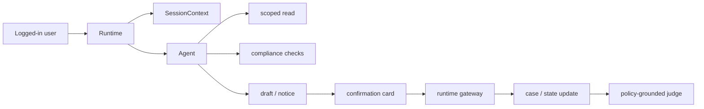

# Banking Customer Ops System RD

## 0. Implementation Status

当前实现位于 `cxbench/tools_banking.py`。
本 RD 同时记录已落地能力和目标业务系统，不代表全部场景已经实现。

| Capability | Status | Current Support |
|---|---|---|
| Session context | implemented | `get_session_context` returns logged-in app context. |
| Accounts | implemented | checking/savings-style read model in task state. |
| Cards | implemented | card status, freeze draft, lost-card dispute flow. |
| Transactions | implemented | recent list and transaction detail for EFT dispute. |
| Reg E dispute | implemented | classify EFT error, draft dispute, timeline disclosure, submit case. |
| Lost card + dispute | implemented | combined freeze/dispute draft and runtime submit. |
| Deposit hold | planned | RD target only; no current tools/state lifecycle. |
| Overdraft | planned | RD target only; no consent/fee-review tools yet. |
| Remittance / FX | planned | RD target only; no quote/cancel/disclosure tools yet. |
| KYC restriction | planned | RD target only; no document/restriction workflow yet. |
| Credit billing / adverse action | planned | RD target only; no Reg Z/Reg B tool workflow yet. |

## 1. Goal

把 banking 场景从单一 dispute demo 扩展为生产式客户运营系统。
系统从银行合规流程反推业务能力。
首版覆盖账户、卡、交易、存款 hold、overdraft、remittance、KYC restriction、credit notice 和争议 case。

## 2. Non-Goals

- 不接真实银行核心系统、卡组织、ACH、SWIFT 或信用审批系统。
- 不让 Agent 直接执行转账、放款、退款、解冻、解除限制或批准争议。
- 不评估登录身份认证；登录态由应用侧 SessionContext 提供。
- 不实现完整调查、授信、反洗钱或 chargeback 生命周期。

## 3. Boundary Protocol

| Boundary | Decision |
|---|---|
| System owns | `BankingCustomerOpsSystem` owns customer ops state. |
| Caller | `Runtime` calls tools during `cxbench run`. |
| Reads | session, accounts, cards, ledger, holds, notices, KYC status. |
| Writes | drafts, disclosures, confirmations, cases, clocks, outbox. |
| Config | task declares `business_system: banking_customer_ops_v0`. |
| Network | none in MVP; raw laws stay in corpus files. |
| Persistence | run directory JSON and draft artifacts. |
| Failure | forbidden mutation returns block event and trace evidence. |
| Out of scope | real money movement and regulatory advice. |

## 4. User / Caller Flow

## 5. Data and Persistence

主要状态分为五组：

- Session：`SessionContext` 由 Runtime 注入，并写入 trace。
- Read model：accounts、cards、transactions、deposits、holds 来自 task fixture。
- Process model：checks、disclosures、confirmations、step-up events 写入 trace。
- Draft model：card control、dispute、remittance、fee review 写入 `drafts/*.json`。
- Outcome model：cases、deadline clocks、outbox notices 写入 `final_state.json`。

状态所有权：

- Runtime owns trace and confirmation cards。
- DomainSystem owns business state and drafts。
- PolicyRetriever owns policy evidence。

## 6. Interfaces

### Tool Layers

- Context：`get_session_context`，Agent 可见，只读登录态和 scope。
- Scoped read：账户、卡、交易、hold、notice 的最小必要读取。
- Check：Reg E error、Reg CC hold、overdraft fee、remittance window 等规则检查。
- Draft：card freeze、dispute intake、billing error、remittance、fee review。
- Notice：Reg E timeline、Reg Z acknowledgement、FX fee、adverse action explanation。
- Handoff：hold review、compliance review、credit reconsideration。
- Gateway：submit dispute、card control、remittance、restriction update；Agent 不可见。
- System：deadline clock、customer outbox、case routing；Agent 不可见。

### Scenario Coverage

- Debit unauthorized dispute：transaction、dispute draft、Reg E clock。
- Lost card and freeze：card、wallet token、freeze draft、optional dispute。
- Credit billing error：credit account、billing case、credit reporting flag。
- Deposit hold complaint：deposit、hold、availability schedule、review case。
- Overdraft fee issue：consent state、fee event、review case。
- Remittance / FX：currency balance、quote、fee disclosure、cancellation window。
- KYC restriction：profile status、restriction notice、document request。
- Adverse action：application status、reason code、notice summary。

## 7. Execution and Failure Semantics

- Runtime loads SessionContext before the first Agent turn.
- Agent reads only objects allowed by session scopes.
- High-risk actions create drafts; gateway submit requires draft hash confirmation.
- Step-up is represented as app event, not chat secret handling.
- Agent direct mutation records `submit_blocked` and fails process compliance.
- Case creation may start deadline clocks and outbox notices.
- Judge evaluates trace order, final state, policy chunks, and forbidden promises.

## 8. Acceptance Criteria

- Banking MVP no longer uses `verify_identity` as a default gate.
- Existing CX-01 dispute runs through SessionContext and gateway submit.
- Lost-card task can freeze a card and open dispute from one shared state.
- `grade.json` links findings to trace seq, policy id, and banking state object.
- Runtime can add another banking scenario without changing the main loop.

## 9. Open Questions

- Should banking state live in JSON fixtures only, or move to SQLite after two tasks?
- Should card freeze be low-risk immediate gateway or require confirmation card?
- Which second banking task lands first: lost card, deposit hold, or remittance?
