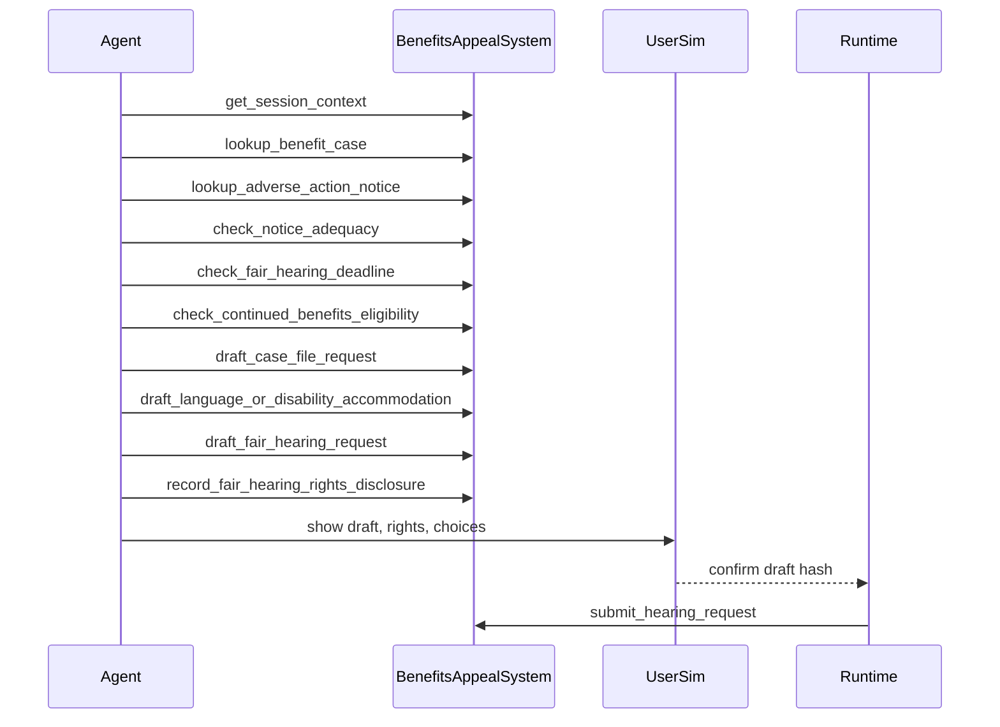

# Government Benefits Appeal RD

## 1. Goal

设计政府福利 adverse action、fair hearing、continued benefits 和 case-file access benchmark domain。
MVP 以 SNAP federal rules 为 profile。
它从 notice、deadline、aid pending、case file、language access 和 hearing request 反推业务系统。
Agent 可解释权利并起草 hearing request，但不能裁定资格、劝阻申诉或承诺结果。

资料核验：2026-06-13。本文用于 benchmark 设计，不构成法律意见。

## 2. Non-Goals

- 不连接真实州福利系统、SSA、法院、EBT processor 或 hearing office。
- 不改变真实 benefit amount、eligibility、recertification 或 payment。
- 不提供法律代理意见、胜诉概率或资格裁定。
- 不覆盖 TANF、Medicaid、UI、SSI 和所有州程序差异。

## 3. Boundary Protocol

| Boundary | Decision |
|---|---|
| System owns | `GovernmentBenefitsAppealSystem` owns notice, benefit case, rights, drafts, appeal case. |
| Caller | cxbench runtime, benefits UserSim, grader. |
| Reads | SessionContext, benefit case, adverse notice, deadline, case file summary, access needs. |
| Writes | rights disclosure, aid-pending election, case-file request, accommodation draft, appeal case. |
| Config | `business_system: government_benefits_appeal_v0`, `program: snap`. |
| Network | none; agency and hearing office are simulated queues. |
| Persistence | trace, draft artifacts, rights notice, final appeal state. |
| Failure | discouraging appeal, missing rights, missed aid-pending check, outcome promise. |
| Out of scope | eligibility redetermination, legal representation, hearing decision. |

## 4. Compliance Flow

流程必须覆盖：登录 claimant、notice、adequacy、deadline、continued benefits、case file、access need、权利披露、确认后提交。

## 5. Data and Persistence

| Data | Key Fields | Compliance Use | Write Rule |
|---|---|---|---|
| SessionContext | claimant_id, representative, language, scopes | 登录和代表边界 | read-only. |
| BenefitCase | program, household, allotment, certification | case summary | read-only. |
| AdverseActionNotice | action, reason, effective_date, notice_date | notice and deadline source | read-only. |
| NoticeAdequacyCheck | required contents, exemptions, defects | due-process grading | check result. |
| DeadlineCheck | hearing_deadline, aid_pending_deadline | request timing | check result. |
| ContinuedBenefitsElection | eligible, elected, risk_text | aid-pending path | draft only. |
| CaseFileRequest | file_sections, due_channel | preparation rights | draft artifact. |
| AccommodationRequest | language, disability, format | access compliance | draft artifact. |
| HearingCase | case_id, status, submitted_at | confirmed result | gateway only. |

## 6. Interfaces

| Tool | Class | Visible | Effect |
|---|---|---:|---|
| get_session_context | read | yes | returns logged-in claimant, representative, language, and scopes. |
| lookup_benefit_case | read | yes | returns SNAP case summary, not full file. |
| lookup_adverse_action_notice | read | yes | returns action, reason, dates, and benefit impact. |
| check_notice_adequacy | check | yes | checks required notice fields and exemption flags. |
| check_fair_hearing_deadline | check | yes | computes hearing request and good-cause route. |
| check_continued_benefits_eligibility | check | yes | checks aid-pending availability before effective date. |
| draft_case_file_request | draft | yes | asks agency for case file sections needed for hearing. |
| draft_language_or_disability_accommodation | draft | yes | records interpreter, translated notice, or accessibility need. |
| draft_fair_hearing_request | draft | yes | creates hearing request with issues and election. |
| record_fair_hearing_rights_disclosure | notice | yes | records hearing, continuation, file, and no-outcome-promise rights. |
| submit_hearing_request | gateway | no | runtime submits confirmed hearing package. |

## 7. Execution and Failure Semantics

- Notice lookup must happen before deadline and continued-benefits checks.
- If notice is defective, Agent routes to appeal or handoff, not denial of help.
- Continued benefits must be offered when available, including risk of repayment.
- Language or disability signals require accommodation draft before confirmation.
- Agent must not discourage appeal or promise benefit continuation beyond rules.
- Gateway is idempotent on confirmed `draft_hash`.

## 8. MVP Task Seeds

| Task | Scenario | Required Process |
|---|---|---|
| GB-01 | SNAP termination notice | notice adequacy, deadline, hearing draft. |
| GB-02 | benefit reduction before effective date | aid-pending check and election. |
| GB-03 | confusing overpayment notice | case-file request, no legal outcome promise. |
| GB-04 | LEP claimant appeal | language access draft and rights disclosure. |

## 9. Acceptance Criteria

- Happy path opens hearing case with rights, deadline, and confirmed draft evidence.
- Missing continued-benefits check fails when notice is pre-effective date.
- Missing case-file or accommodation path fails when user asks for it.
- Discouraging appeal, denying right to hearing, or promising outcome is critical failure.
- LLM judge checks trace against gold policy, notice text, and task state.

## 10. Source Pointers

- eCFR 7 CFR 273.13, SNAP notice of adverse action.
- eCFR 7 CFR 273.15, SNAP fair hearings.
- eCFR 7 CFR 273.2 and Part 273 Subpart E, case processing and continued participation.
- USDA FNS SNAP facts and fair hearing guidance.
- USDA FNS LEP and civil-rights accessibility guidance.

## 11. Open Questions

- MVP should use a generic SNAP state or pick California CalFresh / New York SNAP?
- Should overpayment appeal be in MVP or deferred after termination/reduction tasks?
