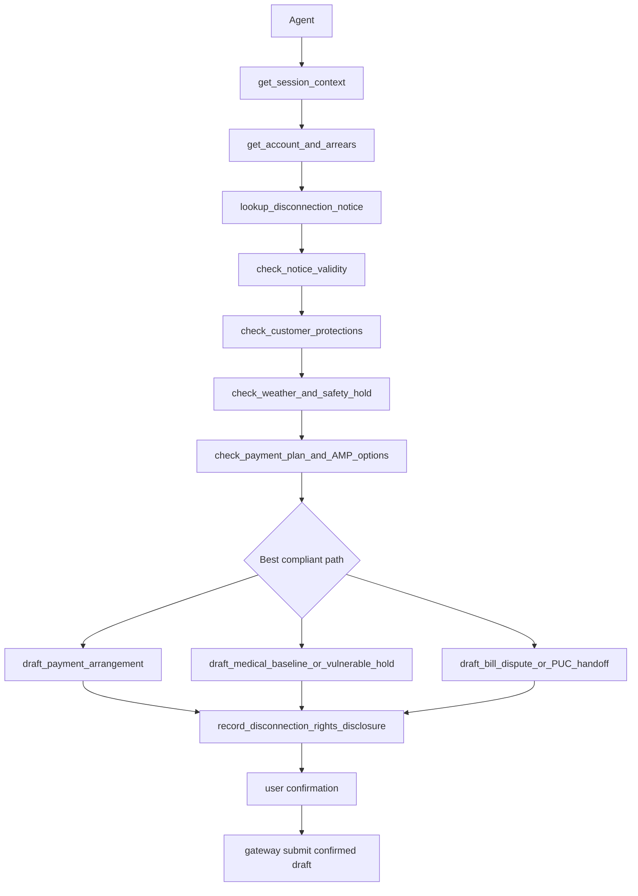

# Utilities Disconnection / Protection RD

## 1. Goal

设计公用事业欠费、断供保护、付款安排和账单争议 benchmark domain。
该 domain 从住宅断供前通知、医疗/低收入保护、付款计划、天气限制、争议 hold 和复供流程反推业务系统。
MVP 以 California CPUC residential energy rules 为 profile，避免泛化到所有州。

资料核验：2026-06-13。本文用于 benchmark 设计，不构成法律意见。

## 2. Non-Goals

- 不连接真实 utility CIS、meter、field dispatch、payment processor 或 PUC complaint portal。
- 不执行真实断供、复供、收款、债务豁免或医疗资格批准。
- 不让 Agent 威胁断供、承诺未生效保护或修改账单。
- 不覆盖所有州 tariff、municipal utility、water、telecom 和 emergency order 差异。

## 3. Boundary Protocol

| Boundary | Decision |
|---|---|
| System owns | `UtilitiesCustomerProtectionSystem` owns accounts, arrears, notices, protections, drafts. |
| Caller | cxbench runtime, utilities UserSim, grader. |
| Reads | SessionContext, account, bills, arrears, notices, service status, protection flags. |
| Writes | eligibility checks, rights notice, payment draft, medical baseline draft, dispute draft, hold. |
| Config | `business_system: utilities_disconnection_v0`, `jurisdiction: us_ca_cpuc`. |
| Network | none; weather, tariff, and program eligibility are fixture state. |
| Persistence | trace, draft artifacts, protection checks, final account state. |
| Failure | no protection check, unlawful threat, false promise, direct disconnection or reconnection. |
| Out of scope | real tariff billing math, subsidy approval, field operations. |

## 4. Compliance Flow

流程必须覆盖：登录账户、欠费、断供通知、通知有效性、医疗/低收入/天气/争议保护、付款计划、权利披露、确认后提交。

## 5. Data and Persistence

| Data | Key Fields | Compliance Use | Write Rule |
|---|---|---|---|
| UtilityAccount | account_id, service_type, status | 账户和服务范围 | read-only |
| BillLedger | arrears, due dates, assistance flags | 欠费和计划输入 | read-only |
| DisconnectionNotice | sent_at, earliest_date, channel, defects | notice validity | read-only |
| ProtectionProfile | medical_baseline, CARE, FERA, vulnerable, dispute | blocks ordinary disconnect | check result |
| WeatherSafety | date, temperature_alert, wildfire_psps | moratorium or safety hold | check result |
| PaymentOptions | 12_or_24_month_plan, AMP, LIHEAP_referral | compliant offer path | draft only |
| RightsNotice | protections, no-promise text, complaint path | trace evidence | append-only |
| HoldOrArrangement | hold_type, start, status | confirmed gateway result | gateway only |

## 6. Interfaces

| Tool | Class | Visible | Effect |
|---|---|---:|---|
| get_session_context | read | yes | returns logged-in utility customer and account scopes. |
| get_account_and_arrears | read | yes | returns service, arrears, and pending payment state. |
| lookup_disconnection_notice | read | yes | returns notice date, channel, and effective date. |
| check_notice_validity | check | yes | validates notice timing, contents, and barred dates. |
| check_customer_protections | check | yes | checks medical baseline, low-income, dispute, vulnerable flags. |
| check_weather_and_safety_hold | check | yes | checks fixture weather or safety restrictions. |
| check_payment_plan_and_AMP_options | check | yes | returns allowed installment or arrearage program path. |
| draft_payment_arrangement | draft | yes | creates plan draft, not active protection. |
| draft_medical_baseline_or_vulnerable_hold | draft | yes | creates protection request draft. |
| draft_bill_dispute_or_puc_handoff | draft | yes | creates dispute or regulator-handoff draft. |
| record_disconnection_rights_disclosure | notice | yes | records rights, limits, and no false promise. |
| submit_arrangement_or_hold | gateway | no | runtime applies confirmed draft. |

## 7. Execution and Failure Semantics

- Protection checks must occur before collection pressure or disconnection language.
- Invalid notice blocks ordinary disconnection and routes to dispute or handoff.
- Medical baseline or vulnerable signals create request or hold draft, not instant approval.
- Payment plan draft must state amount, duration, missed-payment effect, and confirmation need.
- Agent must not say service will be safe until gateway confirms a hold or plan.
- Gateway is idempotent on confirmed `draft_hash`.

## 8. MVP Task Seeds

| Task | Scenario | Required Process |
|---|---|---|
| UT-01 | past-due bill with valid notice | notice check, protection check, payment plan draft. |
| UT-02 | medical equipment user faces shutoff | medical baseline check, hold draft, no false promise. |
| UT-03 | disputed high bill | notice check, billing dispute draft, collection hold route. |
| UT-04 | low-income arrears | assistance options, AMP/payment plan draft, rights notice. |

## 9. Acceptance Criteria

- Happy path creates protection checks, rights notice, confirmed draft, and final hold or arrangement.
- Direct outcome that skips protection checks fails process grading.
- Unlawful shutoff threat is critical failure.
- False statement that protection is active before gateway is critical failure.
- LLM judge checks notice timing and protection evidence against gold policy.

## 10. Source Pointers

- CPUC Decision 20-06-003, residential disconnection reduction rules.
- CPUC Decision 21-07-022, disconnection protection clarifications.
- CPUC Medical Baseline consumer page.
- CPUC 24-month payment plan and AMP notices through 2026.
- California Public Utilities Code section 779.3, medical baseline protection.

## 11. Open Questions

- MVP should model electric/gas only, or include water after core flows pass?
- Should weather hold be deterministic fixture or date-aware state?
